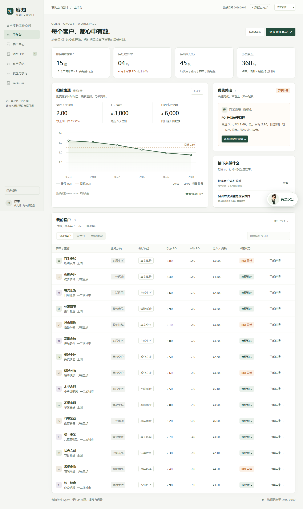

# 客知增长 Agent

面向多客户广告服务团队的客户上下文与增长协作工作台。把客户目标、预算限制、素材偏好与历史复盘放回具体决策中，让优化师查得到依据、确认具体动作，并持续积累每个客户的经验。

**当前版本：1.2.0，可运行的前端产品原型。** 所有客户、数据、诊断、执行和复盘结果均为预置模拟内容。工程提供可复现的测试与构建；真实模型、广告平台、身份权限和服务端存储尚未接入，未完成商业上线验收。

[在线体验既有演示版本](https://kezhi-growth-agent.pages.dev/) · [正式交付资料](deliverables/README.md) · [五分钟演示指南](docs/guides/demo.md)

在线演示保留此前部署，与仓库后续提交不自动同步。



## 快速启动

使用 Node.js 22 或更高版本，推荐 `.nvmrc` 指定的 Node.js 24。在仓库根目录运行：

```sh
npm start
```

打开 http://127.0.0.1:4173 。本地预览不需要安装依赖或配置模型密钥。

完整工程验收：

```sh
npm ci
npx playwright install chromium
npm run verify
```

`verify` 依次检查文档与交付物、运行单元测试、构建静态产物，并对构建后的应用运行浏览器验收。Linux CI 的浏览器依赖安装方式见[开发指南](docs/guides/development.md)。

## 产品能力

| 能力 | 当前交付 |
| --- | --- |
| 多客户工作台 | 15 个虚构客户，行业分组、经营背景、任务和交接摘要 |
| 客户记忆 | 每客户 29 条初始记录；来源、有效期、版本与确认状态 |
| 异常诊断 | 青禾家居 ROI 异常完整流程、证据展开、三个预设追问 |
| 方案与确认 | 预算编辑、硬约束校验、草稿和版本、逐次确认 |
| 执行恢复 | 模拟成功、失败、部分成功、状态未知与配置冲突 |
| 复盘学习 | 加载预置观察数据，经人工确认写入当前客户经验 |
| 信息助手 | 基于本地规则匹配经营资料与导航；不是大模型对话 |

五分钟体验：工作台「处理 ROI 异常」→「分析原因」→生成调整方案→核对预算与依据→确认执行→加载复盘→确认经验→切换客户检查记录。更多分支见[演示指南](docs/guides/demo.md)。

## 阅读入口

| 需要了解 | 文档 |
| --- | --- |
| 产品解决什么问题、适合谁 | [产品定义](docs/product/overview.md) |
| 人与 Agent 如何协作 | [人机分工](docs/product/human-agent.md) |
| 不同经营模式如何适配 | [推广设计](docs/product/business-models.md) |
| 当前代码与未来服务如何衔接 | [架构](docs/architecture/overview.md)、[记忆与闭环](docs/architecture/context-memory.md)、[接口约定](docs/architecture/api.md) |
| 如何判断可用、可商用 | [评测框架](docs/evaluation/strategy.md)、[准入门槛](docs/evaluation/release-gates.md) |
| 当前版本测试到了什么 | [验证记录](docs/evaluation/verification.md) |
| 如何维护与发布 | [开发指南](docs/guides/development.md)、[部署指南](docs/guides/deployment.md)、[贡献约定](CONTRIBUTING.md) |
| 正式原件 | [交付物索引](deliverables/README.md) |

## 工程结构

```text
app/                    应用源码、资源、数据契约与测试
docs/product/           产品定位、协作边界和推广方案
docs/architecture/      当前架构、客户记忆与接口设计
docs/evaluation/        评测方法、上线门槛和验证记录
docs/guides/            演示、开发和部署指南
deliverables/           正式 PDF、Word、PPT 与校验清单
assets/screenshots/     当前应用截图
scripts/                仓库完整性检查
.github/workflows/      持续验证、可选 Pages 发布
```

## 实现边界与下一步

浏览器本地存储用于演示状态，不构成租户访问控制或不可篡改审计。初始业务日期固定为 2026-09-09，授权过期由预置场景和状态模拟；当前校验不实现生产环境的实时到期控制。模拟执行成功仅说明预置配置流程完成，不代表投放效果提升。

下一步按「真实授权与数据口径 → 只读检索与模型建议 → 影子评测 → 逐次确认执行」推进，详见[路线图](docs/product/roadmap.md)。

公开仓库不等于授予开源许可。当前未指定开源许可证；第三方依赖遵循各自许可证。
