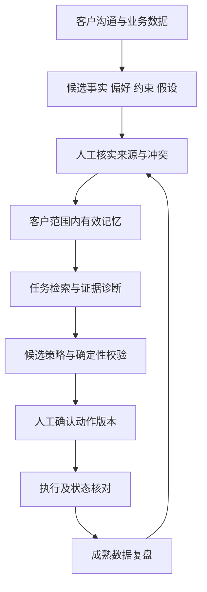

# 客户上下文与记忆闭环

## 产品设计

从客户沟通、历史投放、素材反馈和复盘中识别经营事实、偏好、约束与假设。将候选记录连回原始来源，经确认后在相同客户和适用条件内调用。未经确认或已经失效的内容不能覆盖有效硬约束。

## 当前数据映射

| 概念 | 原型字段 | 生产设计差距 |
| --- | --- | --- |
| 客户范围 | `records[clientId]` | 服务端租户、用户与账户关系验证 |
| 记忆内容 | `id/type/text` | 结构化约束、适用条件和来源事件 |
| 证据 | `source/original/sourceTag` | 可授权访问的证据 ID 与不可变快照 |
| 生命周期 | `status/expires/version` | 真实时钟、撤销、冲突消解与审批人 |
| 策略 | `task.budgets/version/acknowledged` | 完整策略快照、证据引用和预览有效期 |
| 执行 | `execution.items/status` | 幂等键、平台回执及持久化逐项状态 |
| 经验 | 确认复盘后新增历史经验 | 成熟窗口、因果限制和跨任务再验证 |

原型允许新增待确认记忆、编辑状态及有效期、停用、查看来源和确认复盘。它没有自动抽取、向量检索、自动冲突仲裁或在线学习模型。预算等关键文本被锁定，数值仍来自预置客户配置。

## 调用与约束优先级

建议生产实现按“权限范围 → 硬约束 → 任务相关性 → 有效期与版本 → 来源可信度”筛选。冲突无法消解时列出冲突并补查，不挑选更利于生成策略的一条。事实与偏好可以参与解释，未经验证的假设不能直接被描述为因果结论。

当前 `domain.validate` 检查非负整数预算、总额保持、数据完整状态、关键记录的确认状态、观察天数和人工复核阈值。它是演示规则，不覆盖真实资金精度、记录缺失、动态授权到期和服务端并发。

## 写回与遗忘

复盘必须依据实际执行动作，并区分配置成功、观察改善与因果增益。当前预置观察数据为消耗 3,000 元、成交 7,200 元、ROI 2.40，不能作为效果证据。经验确认后只写回当前客户，并记录执行批次来源。

生产系统需支持到期停用、撤销错误经验、按条件重新验证及保留历史版本。客户切换时还应清理会话检索结果和上下文缓存，避免只切换界面而继续使用旧客户上下文。

依据：[产品方案](../../deliverables/product-overview.pdf)、[评测方案](../../deliverables/evaluation-plan.pdf)、[现有领域实现](../../app/domain.js)。
