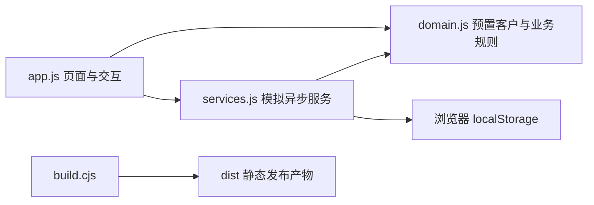
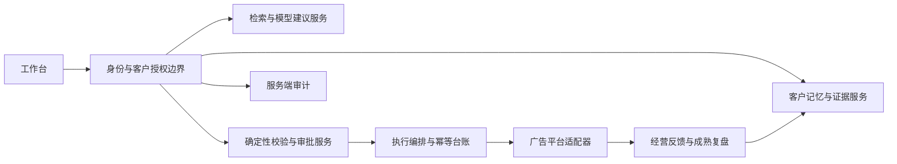

# 工程架构

## 当前实现

应用使用原生 HTML、CSS 和 JavaScript，在浏览器运行，无运行时第三方前端依赖。Node.js 只用于本地静态预览、打包和工程测试；`server.cjs` 不是业务后端。

| 文件 | 职责 |
| --- | --- |
| `app/index.html` | 页面入口，依次加载领域、服务和交互脚本 |
| `app/app.js` | 导航、渲染、编辑、确认、执行恢复、复盘及规则式助手 |
| `app/domain.js` | 15 个客户、初始记忆、预算校验与模拟执行状态 |
| `app/services.js` | 浏览器存储及带延迟的模拟诊断、生成、执行和查询 |
| `app/contracts.d.ts` | 未来服务接口类型草案，不是现有后端实现 |
| `app/server.cjs` | 仅监听回环地址，只暴露允许的页面与静态资源 |
| `app/build.cjs` | 复制发布资源并验证引用，不打包文档或测试 |

## 状态边界

存储键为 `kezhi-demo-v1`，数据结构版本为 `schema: 2`，按 `records[clientId]` 保存记忆、任务、复盘和日志。它支持刷新恢复，不提供多用户权限、跨设备同步或可靠审计。不同客户记录在 UI 中分开，不代表浏览器层有安全隔离。

任务阶段从异常详情到诊断、方案、确认和结果。执行总体状态包含 `running`、`success`、`partial`、`failed`、`unknown`；明细额外包含 `pending`、`unchanged`。页面恢复时把未完成的 `running` 转为 `unknown`，待后续查询。模拟查询将未知批次转为预置成功，真实系统必须回读平台。

## 后续服务架构建议

服务端每次读写都验证客户与账户归属。检索、缓存、导出、日志同样需要客户范围，不能仅依赖请求中的 `clientId`。模型只输出结构化候选建议，校验、授权、执行和最终状态由确定性代码与平台响应负责。

先实现只读数据和人工登记，再增加真实执行。具体契约见[接口约定](api.md)及[类型草案](../../app/contracts.d.ts)。
